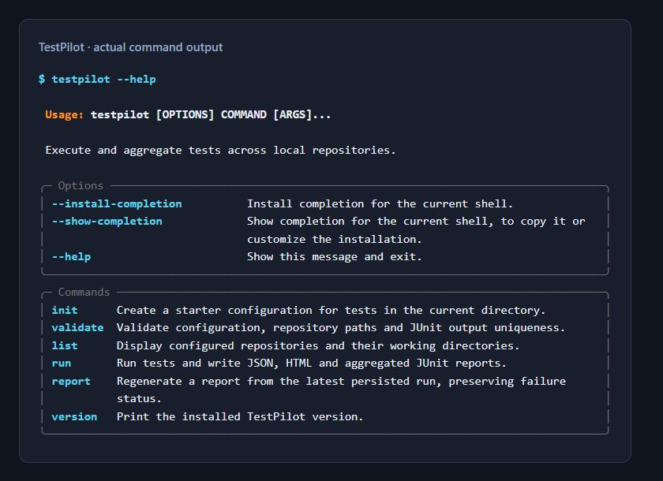
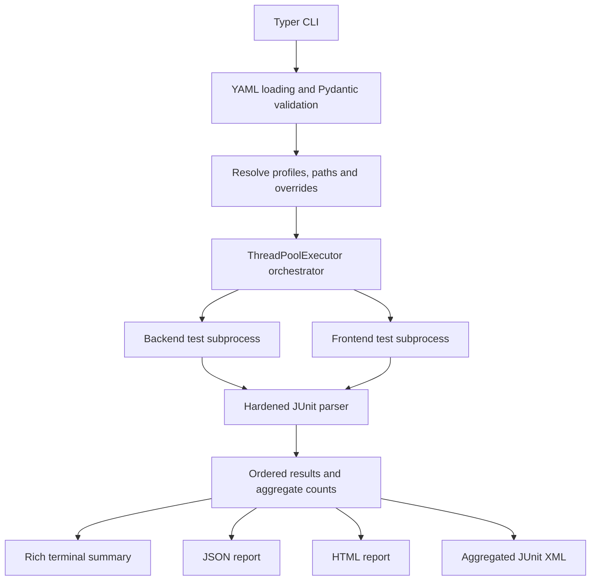
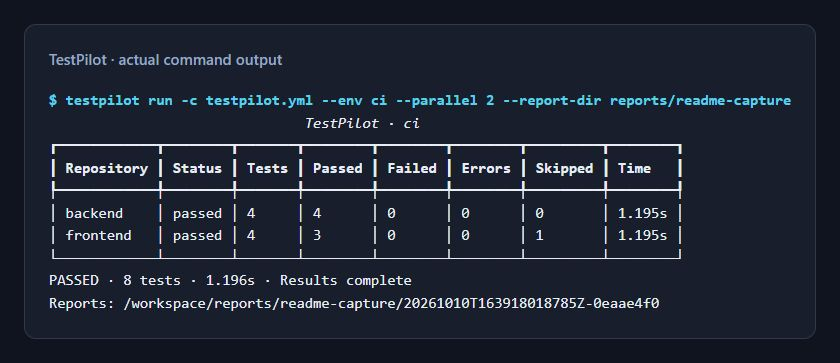
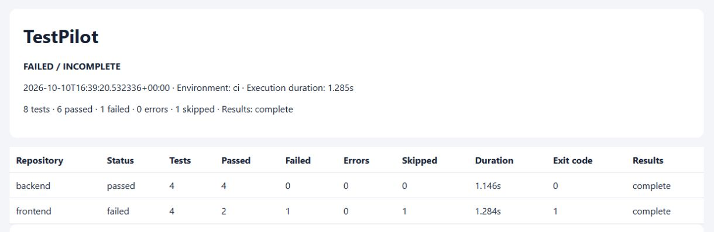
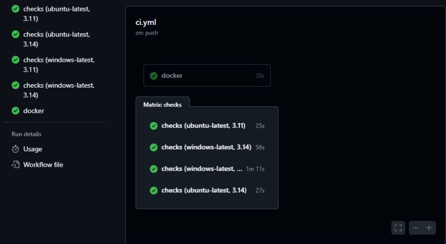

<div align="center">

<h1>TestPilot</h1>
<p><strong>Multi-Repository Test Orchestration &amp; Reporting CLI</strong></p>
<p>Run independent test suites from one command.<br>Bring their results together in reports that make failures and missing evidence visible.</p>

<p>
<a href="https://github.com/YoussefSelk/testpilot/actions/workflows/ci.yml"></a>
<a href="https://www.python.org/"></a>
<a href="LICENSE"></a>
<a href="https://github.com/astral-sh/ruff"></a>
<a href="#development"></a>
<a href="#docker"></a>
</p>

<p>
<a href="#overview">Overview</a> · <a href="#features">Features</a> · <a href="#quick-start">Quick Start</a> · <a href="#architecture">Architecture</a> · <a href="#cli">CLI</a> · <a href="#reports">Reports</a> · <a href="#cicd">CI/CD</a> · <a href="#docker">Docker</a> · <a href="#development">Development</a>
</p>

</div>

## Overview

A change spanning a backend and a frontend often means running tests in separate
repositories, checking different exit codes, and opening several JUnit reports.
TestPilot gives that workflow one entry point: declare local repositories, select
an environment profile, and collect their execution results in one place.

For example, a developer can test an inventory service and its presentation
layer together before opening a pull request. CI can run the same configuration
and preserve the same reports. TestPilot orchestrates existing test commands;
it does not replace the testing frameworks inside your repositories.

## Features

| Capability | What it provides |
| --- | --- |
| Multi-repository orchestration | Validated local paths and explicit argument-array commands |
| Parallel execution | Configurable workers, sequential mode, and stable result ordering |
| Environment profiles | Variables, timeouts, concurrency and report-directory overrides |
| JUnit aggregation | Testcase outcomes and details, with hardened XML parsing |
| Consolidated reports | Rich terminal summary, JSON, escaped HTML and aggregate JUnit XML |
| Failure handling | Captured output, nonzero exits, deadlines and interruption cleanup |
| CI/CD and Docker | Three pipeline examples and a verified non-root CLI image |

## Quick Start

Clone the repository and create an isolated environment:

```bash
git clone https://github.com/YoussefSelk/testpilot.git
cd testpilot
python -m venv .venv
```

Activate it on Linux/macOS:

```bash
source .venv/bin/activate
```

Or in Windows PowerShell:

```powershell
.\.venv\Scripts\Activate.ps1
```

Install, validate, and run the bundled offline repositories:

```bash
python -m pip install -e ".[dev]"
testpilot validate -c testpilot.yml
testpilot list -c testpilot.yml
testpilot run -c testpilot.yml --env local
testpilot report --input reports --format html --output reports/demo.html
```

The example returns **exit 0: 8 tests, 7 passed, 1 skipped**. Open
`reports/demo.html` in a browser:

```bash
# Linux
xdg-open reports/demo.html
# macOS
open reports/demo.html
```

```powershell
# Windows
Start-Process reports/demo.html
```

For your own repositories, generate a separate starter file:

```bash
testpilot init -c starter-testpilot.yml
testpilot validate -c starter-testpilot.yml --env local
```

Edit its repository paths and commands before use. The committed `testpilot.yml`
is already configured for the demo; `init` refuses to overwrite existing files.
Runtime-only installation is `python -m pip install .`. The distribution is
`testpilot-cli`; the executable and import package are `testpilot`. No PyPI
release is claimed.

## CLI



| Command | Purpose |
| --- | --- |
| `init` | Create a starter YAML configuration |
| `validate` | Check configuration, directories and JUnit output uniqueness |
| `list` | Show configured repositories and working directories |
| `run` | Execute selected suites and write all report formats |
| `report` | Regenerate a report from a persisted run |
| `version` | Print the installed version |

```bash
testpilot run --env ci --parallel 4
testpilot run --repo backend --timeout 120
testpilot run --parallel 1 --report-dir reports/sequential
testpilot report --input reports --format json --output reports/demo.json
testpilot report --input reports --format junit --output reports/combined.xml
testpilot version
python -m testpilot --help
```

Use `--help` on any command. Repeat `--repo` to select several repositories.
Paths supplied with `--report-dir` resolve relative to the configuration file.

## Configuration

This complete example runs the included backend and frontend independently:

```yaml
version: 1
defaults:
  timeout: 300
  parallel: 2
  report_dir: reports
profiles:
  local:
    env: {APP_ENV: local}
  ci:
    env: {APP_ENV: test}
    parallel: 4
repositories:
  - name: backend
    path: examples/repo_a
    command: [python, -m, pytest, tests/, -q, --junitxml=test-results.xml]
    junit: test-results.xml
  - name: frontend
    path: examples/repo_b
    command: [python, -m, pytest, tests/, -q, --junitxml=test-results.xml]
    junit: test-results.xml
```

Repository paths resolve relative to the YAML file. Optional `working_dir`
resolves relative to the repository; `junit` resolves relative to that working
directory. The command must actually generate the configured XML: TestPilot
never adds framework-specific report flags for you.

Precedence is explicit: **defaults → profile → repository → CLI**, where the
setting is supported. Environment variables start with the inherited process
environment, then defaults, profile and repository values. Repository overrides
apply to timeout and variables; worker count and report directory can be
changed by profiles and CLI options. Without `--env`, defaults apply.

See the [full configuration reference](docs/configuration.md) for validation,
absolute paths, all four sample profiles and operational limits. Supply secrets
through the environment or your CI secret store; captured test logs may contain
whatever the test programs print.

## Architecture



Each worker owns its subprocess and output capture. The runner reads that
repository's JUnit evidence after execution; the orchestrator assembles results
in configuration order. Structured result models derive counts and success, and
reporting modules render the same evidence for people and CI consumers.
See [architecture decisions](docs/architecture.md).

## Execution



The screenshot shows a real two-worker run. The CLI displays a final summary;
it does not currently stream live progress. Durations vary by machine and run.

Commands execute without `shell=True`. A nonzero command exit or a failed/error
testcase makes the run fail. A timeout stops the owned process group/tree and
records available results; cancellation stops queued work and cleans up running
children. Final report ordering stays predictable even when suites finish in a
different order.

Missing, malformed, stale or empty JUnit evidence is **incomplete**, never a
successful test run. TestPilot clears each dedicated JUnit output file before
execution and rejects shared output paths within a run. Avoid overlapping
invocations against the same repository-generated files.

## Reports



This HTML screenshot comes from a deliberately failing demo: **8 tests,
6 passed, 1 failed, 1 skipped**, with exit code 1. The ordinary demo passes.
[Capture provenance](docs/assets/README.md) records how all screenshots were made.

Every run writes a unique `reports/<timestamp>-<id>/` directory:

- **`run.json`**: canonical evidence, timestamps, profile, exit codes, durations,
  counts, testcase details, stdout/stderr and completeness.
- **`report.html`**: repository breakdown, testcase results and expandable logs.
- **`junit.xml`**: combined testcases, plus explicit execution errors for CI.

`report --input` accepts a JSON file, a run directory, or a report root; a root
selects its latest immediate child run. Aggregate JUnit adds a synthetic
`__testpilot_execution__` error when evidence is incomplete or an execution
failure has no failed testcase, so its totals can exceed actual test counts.

Exit codes: **`0`** success; **`1`** failed/incomplete execution;
**`2`** usage, configuration or report I/O error; **`130`** interrupted execution.
The `report` command also returns nonzero for failed/incomplete saved runs.

To see failure handling yourself:

```bash
testpilot run -c examples/testpilot-failing.yml --env ci
# Expected exit 1; reports remain under reports/failure-demo/.
```

## CI/CD



[The captured GitHub Actions run](https://github.com/YoussefSelk/testpilot/actions/runs/38068204059)
passed all five jobs and preserved five report artifacts. The badge at the top
tracks the current `main` workflow; the screenshot documents that specific run.

- **[GitHub Actions](.github/workflows/ci.yml)** runs Linux/Windows checks with
  Python 3.11 and 3.14, plus a Docker build and mounted-repository demonstration.
- **[GitLab CI](.gitlab-ci.yml)** runs the same checks in Python 3.11 slim and
  publishes JUnit results and artifacts, including after failures.
- **[Jenkins](Jenkinsfile)** uses a Python container and archives reports in
  `post { always { ... } }`. It needs a Linux Docker-capable agent and the
  Docker Pipeline and JUnit plugins.

All three call [`scripts/check.py`](scripts/check.py): lint, format, types,
unit/integration tests, configuration validation and a real orchestration demo.
The script preserves the first failure's exit status. GitHub Actions has actually
run; GitLab and Jenkins configurations have not been executed on hosted services.

## Docker

```bash
docker build -t testpilot:local .
docker run --rm testpilot:local --help
```

The image runs as non-root UID `10001` and includes pytest for the offline demo.
Mount your repositories explicitly; the container cannot see host paths by itself.
On Linux/macOS, use your UID for writable repository and report mounts:

```bash
mkdir -p reports
docker run --rm --user "$(id -u):$(id -g)" \
  --mount "type=bind,src=$PWD,dst=/workspace" \
  testpilot:local run -c /workspace/testpilot.yml --env ci
```

Windows PowerShell with Docker Desktop's Linux engine:

```powershell
New-Item -ItemType Directory -Force reports | Out-Null
docker run --rm --mount "type=bind,src=$($PWD.Path),dst=/workspace" `
  testpilot:local run -c /workspace/testpilot.yml --env ci
```

Reports are written back to the mounted `reports/` directory. For other projects,
mount their repositories separately and use container paths in YAML. The
container user needs write access to JUnit locations and reports. Extra test
frameworks/dependencies require a derived image. Read-only repository mounts
need a separate writable JUnit destination and the matching test-command flag.

## Project Structure

```text
.github/workflows/ci.yml   GitHub Actions
src/testpilot/
  cli.py                  Commands and terminal summary
  config.py, models.py    Configuration and structured result contracts
  runner.py               Subprocess lifecycle and JUnit collection
  orchestrator.py         Parallel execution and ordered run results
  junit.py                Hardened XML parsing and count validation
  reporting/              JSON, HTML and aggregate JUnit generation
tests/                    Unit and real subprocess integration tests
examples/                 Offline backend/frontend suites and YAML configurations
docs/                     Architecture, configuration and screenshot assets
scripts/check.py          Shared CI quality gates and demonstration
.gitlab-ci.yml            GitLab CI
Jenkinsfile               Jenkins pipeline
Dockerfile                Non-root CLI image
pyproject.toml            Packaging, dependencies and quality-tool configuration
testpilot.yml             Ready-to-run local demonstration
```

The source separates configuration, process ownership, execution coordination
and rendering. Tests use temporary repositories and real subprocesses rather
than requiring network services.

## Development

```bash
python -m pip install -e ".[dev]"
python scripts/check.py
# Individual checks:
python -m pytest
python -m ruff check .
python -m ruff format --check .
python -m mypy
python -m build
```

At the captured implementation revision, the full suite passed **60 tests on
Linux** and **58 tests on Windows**, with two POSIX-only signal checks skipped
on Windows. The sample repository's intentional skip is separate from those
platform skips. The wheel, source distribution, Docker CLI and failure exit
behavior were also verified.

## Roadmap

Not implemented yet: multiple JUnit files per repository, streamed progress,
output size limits and explicit retry policies. TestPilot currently operates on
trusted local commands; it does not clone repositories, provision dependencies,
provide a subprocess sandbox or run a distributed scheduler.

## Contributing and License

Open an issue with a reproducible case, or submit a focused pull request with
relevant tests. Run `python scripts/check.py` before submitting code changes and
keep configuration examples and CLI documentation consistent with the behavior.

TestPilot is licensed under the [MIT License](LICENSE).
