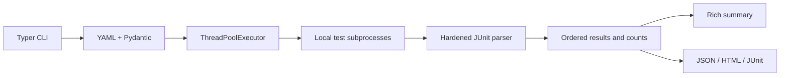

# TestPilot

TestPilot runs automated tests across local repositories, combines their JUnit
results, and produces terminal, JSON, HTML and JUnit reports. It is a small Python
CLI for developers who need one test command for a multi-repository project.

## Features

- Validated YAML configuration and local, development, staging and CI profiles.
- Argument-array subprocess commands, output capture, deadlines and cancellation.
- Sequential or parallel execution with stable repository ordering.
- Hardened JUnit parsing, failure details and explicit incomplete-result status.
- Reports for humans and CI consumers; missing evidence never becomes success.
- Offline sample repositories, GitHub Actions, GitLab CI, Jenkins and Docker.

## Architecture



See [architecture decisions](docs/architecture.md). The CLI handles configuration
and exits, workers own their processes, and reporting consumes structured results.

## Installation

Requires Python 3.11+ and dependencies for each repository's own tests. From a
checkout, install TestPilot and its development tools:

```bash
python -m venv .venv
# Linux/macOS:
source .venv/bin/activate
# Windows PowerShell instead:
# .\.venv\Scripts\Activate.ps1
python -m pip install -e ".[dev]"
testpilot --help
```

For a runtime-only installation use `python -m pip install .`. The distribution
name is `testpilot-cli`; the executable and import package are `testpilot`.
This project is published as source on GitHub; no PyPI release is claimed.

## Quick start

The committed configuration runs two independent, offline sample repositories:

```bash
testpilot validate -c testpilot.yml
testpilot list -c testpilot.yml
testpilot run -c testpilot.yml --env local
testpilot report --input reports --format html
testpilot report --input reports --format json
```

Expected demo counts: **8 tests, 7 passed, 1 skipped**, with exit code 0. The
backend checks inventory reservations and the frontend checks presentation logic.
Reports appear in `reports/<UTC timestamp>-<unique id>/`.

In another project, `testpilot init` creates a starter configuration for pytest
in the configuration's directory. It refuses to overwrite an existing file.
Edit its paths and test commands, then validate and run it. The alternative
`examples/testpilot.yml` resolves its repository paths relative to `examples/`.

## Configuration reference

```yaml
version: 1
defaults:
  timeout: 300
  parallel: 2
  report_dir: reports
  env:
    APP_ENV: local
profiles:
  ci:
    timeout: 600
    parallel: 4
    report_dir: reports/ci
    env:
      APP_ENV: test
repositories:
  - name: backend
    path: examples/repo_a
    working_dir: .
    command: [python, -m, pytest, tests/, -q, --junitxml=test-results.xml]
    timeout: 120
    env:
      FEATURE_MODE: test
    junit: test-results.xml
```

| Field | Meaning |
| --- | --- |
| `version` | Required schema version, currently `1` |
| `defaults.timeout` | Positive finite seconds; default `300` |
| `defaults.parallel` | Workers from `1` to `256`; default `2` |
| `defaults.report_dir` | Output directory relative to the config; default `reports` |
| `defaults.env` | String environment variables layered over inherited variables |
| `profiles` | Named overrides of defaults and environment variables |
| `repositories` | Nonempty ordered list of repository settings |
| `name` | Unique identifier using letters, digits, `_`, `.` and `-`; starts with a letter/digit |
| `path` | Existing directory; relative to the config file or absolute |
| `command` | Nonempty list of program arguments; shell strings are rejected |
| `working_dir` | Existing directory relative to `path`, or an absolute directory |
| `timeout` | Optional repository timeout |
| `env` | Optional repository environment overrides; YAML values must be strings |
| `junit` | Optional XML file relative to the working directory, or absolute |

Unknown keys and unknown profile/repository selections are errors. The command
must produce the configured XML: **setting `junit` does not add command flags**.
TestPilot clears the previous configured JUnit file before execution to avoid
stale results. Use a dedicated generated file, never a source file. Repositories
in a run cannot share the same resolved JUnit output path.

Environment precedence, from lowest to highest: inherited process environment,
`defaults.env`, profile `env`, repository `env`. For timeout: defaults, profile,
repository, CLI `--timeout`. For parallelism and output directory: defaults,
profile, CLI. There are no repository-specific worker/report-directory settings.
Without `--env`, defaults apply and the report environment is `default`.

Environment values are not printed by TestPilot. Supply real secrets through
your environment or CI secret store; examples contain none. Captured test logs
can contain whatever the test programs print, so review reports before sharing.

## CLI examples and exit codes

```bash
testpilot init -c new-testpilot.yml
testpilot validate -c testpilot.yml --env ci
testpilot list -c testpilot.yml
testpilot run --env ci --parallel 4
testpilot run --repo backend --repo frontend --timeout 120 --report-dir reports/custom
testpilot report --input reports --format junit --output combined.xml
testpilot version
python -m testpilot --help
```

`report --input` accepts a canonical `run.json`, a single run directory or a
report root. A root selects the most recent timestamp-named immediate child run;
use an explicit directory to choose a historical run. It regenerates reports
from persisted evidence and does not execute tests.

| Exit | Meaning |
| --- | --- |
| `0` | Complete successful execution/report, or successful utility command |
| `1` | Failed tests, executable failure, timeout or unavailable/incomplete results |
| `2` | CLI usage, configuration, report input/output or filesystem error |
| `130` | Interrupted test execution |

An intentional failure demonstration is available:

```bash
testpilot run -c examples/testpilot-failing.yml --env ci
# Expected exit 1; artifacts remain under reports/failure-demo/.
```

## Parallel execution

```bash
testpilot run --parallel 1  # Sequential
testpilot run --parallel 4  # Up to four independent processes
```

Workers use `ThreadPoolExecutor` and each subprocess owns its capture files.
The final order follows configuration order, independent of completion order.
On timeout or interruption, POSIX process groups are killed; Windows uses
`taskkill /T /F` with a direct-process fallback. Ctrl+C and SIGTERM cancellation
stop queued jobs and preserve results for completed/interrupted repositories.
Processes that intentionally detach from the owned tree can escape cleanup.

Activate the environment containing your test dependencies. Bare executable
names are resolved through the configured `PATH`, including on Windows. Specify
an explicit interpreter path when a repository requires a different environment.
Shell operators, variable interpolation and Windows `.bat`/`.cmd` executables
are not supported; use direct executable argument arrays.

## Environment profiles

The main example provides `local`, `development`, `staging` and `ci`:

```bash
testpilot run --env development
testpilot run --env staging --parallel 1
testpilot run --env ci --parallel 4
```

Profiles override variables and defaults only; repository-specific settings
remain higher priority. TestPilot does not provision environments or dependencies.

## Reports

Each run directory contains:

- `run.json`: timestamp, profile, duration, ordered execution results, stdout,
  stderr, exit codes, testcase details, aggregate counts and success/completeness.
- `report.html`: escaped summary, testcase results and expandable captured logs.
- `junit.xml`: consolidated testcases plus explicit execution errors for CI.

For the normal demo, the JSON summary contains:

```json
{
  "environment": "local",
  "counts": {"tests": 8, "passed": 7, "failed": 0, "errors": 0, "skipped": 1},
  "success": true,
  "results_complete": true
}
```

Missing/malformed XML, mismatched declared counts, empty suites and absent JUnit
configuration are incomplete and return nonzero. A zero-exit command alone is
insufficient evidence. Failed/error testcases also fail a zero-exit command.
Partial parsed results remain visible on timeout/interruption. DTDs, entities
and external entities are rejected using `defusedxml` with ElementTree semantics.
Nested suites are counted by testcase elements, not by summing parent counters.

Aggregate JUnit adds a synthetic `__testpilot_execution__` error when execution
is unsuccessful without a testcase failure, or evidence is incomplete. Its totals
therefore may exceed the actual test counts in JSON/HTML. This ensures CI JUnit
consumers do not display missing test results as success.

## GitHub Actions

[`.github/workflows/ci.yml`](.github/workflows/ci.yml) installs dependencies,
caches pip, runs the shared checks and demo on Linux/Windows with Python 3.11
and 3.14, and uploads reports even after failure. A separate Docker job builds
the image and executes the CLI against a writable mounted checkout. Action
references are pinned to commit SHAs. Push/PR events run it automatically.

## GitLab CI

[`.gitlab-ci.yml`](.gitlab-ci.yml) uses Python 3.11 slim, caches pip, runs the
same checks and demo, and preserves both raw artifacts and JUnit results on
failure. It runs when this source is hosted in a GitLab project with a runner.

## Jenkins

[`Jenkinsfile`](Jenkinsfile) runs installation, checks and the demo in a Python
3.11 container and archives reports in `post { always { ... } }`. It requires a
Linux Docker-capable agent, Docker Pipeline and JUnit plugins, and an SCM-backed
pipeline. The shared script returns the first failed command's status; no
pipeline suppresses failures. Pip cache remains in the Jenkins workspace.

## Docker

```bash
docker build -t testpilot:local .
docker run --rm testpilot:local --help
```

The image uses Python 3.11 slim and runs as UID `10001`. It includes pytest for
the offline demonstration; other frameworks/dependencies need a derived image.
It can only access repositories explicitly mounted into the container.

Linux/macOS, running the bundled sample repositories as your user:

```bash
mkdir -p reports
docker run --rm --user "$(id -u):$(id -g)" \
  --mount "type=bind,src=$PWD,dst=/workspace" \
  testpilot:local run -c /workspace/testpilot.yml --env ci
```

Windows PowerShell with Docker Desktop's Linux engine:

```powershell
New-Item -ItemType Directory -Force reports | Out-Null
docker run --rm --mount "type=bind,src=$($PWD.Path),dst=/workspace" `
  testpilot:local run -c /workspace/testpilot.yml --env ci
```

For external repositories, mount them separately and use container paths in the
YAML, such as `/repos/backend`. Mount the configuration and report directory too.
The container user needs write access to reports and each configured JUnit
location. Read-only repository mounts require redirecting JUnit to a separate
writable mounted directory and changing the command's report flag accordingly.

## Testing and development

```bash
python -m pip install -e ".[dev]"
python scripts/check.py
# Individual checks:
python -m pytest
python -m ruff check .
python -m ruff format --check .
python -m mypy
python -m build
```

The shared CI script runs lint/format/type checks, real subprocess integration
tests, coverage/JUnit output, configuration validation and the offline demo.
Tests need no external services. The POSIX SIGINT integration check is skipped
on Windows; the Linux CI matrix executes it. The demo's intentional skip is
separate from the framework's platform-specific test skip.

## Limitations

- Local repositories only; no cloning, dependency installation or remote runners.
- One JUnit file per repository. Summary-only XML without testcase evidence is
  incomplete; dialects with inconsistent declared counters are rejected.
- Commands and repositories are trusted local code; subprocess isolation is not
  a sandbox. Output is captured to temporary files, then loaded into reports.
- Avoid simultaneous TestPilot invocations against the same JUnit locations:
  unique consolidated run directories do not isolate repository-generated files.
- No distributed scheduling, retry policy, streamed logs or report dashboard.
- GitLab/Jenkins require their respective hosted environments; file presence
  and local shared-script checks are distinct from a hosted pipeline run.

## Roadmap

Potential future work: multiple JUnit files per repository, output size limits,
streamed progress and explicit retry policies. These are not MVP features.

## License

[MIT](LICENSE).
