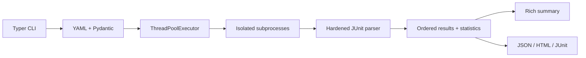

# Architecture and implementation decisions

TestPilot is a local multi-repository CLI. YAML models validate argument arrays,
paths, uniqueness and resource settings before execution. Paths resolve relative
to the configuration file; working directories resolve relative to repositories;
JUnit paths resolve relative to working directories.

Configuration precedence: inherited process environment, defaults, profile,
repository, then CLI overrides for concurrency, timeout and report directory.
Parallel results retain configuration order. A cancellation event stops workers;
each worker owns its process group and output capture. Reports use unique run
directories and never share JUnit locations within a run. Commands are trusted
programs supplied as arrays and execute with shell=False.

Hardened XML parsing counts testcase elements once, checks declared counts and
rejects inconsistent reports. Missing, stale, malformed or empty results are
incomplete, never successful. JSON is the validated persistence format; HTML and
JUnit are generated from it. Commands return 0 for success, 1 for failed or
incomplete tests, 2 for usage/configuration/I/O errors, and 130 for interruption.

The MVP does not clone repositories, provision test dependencies, expand shell
expressions or schedule overlapping invocations against the same test directory.
